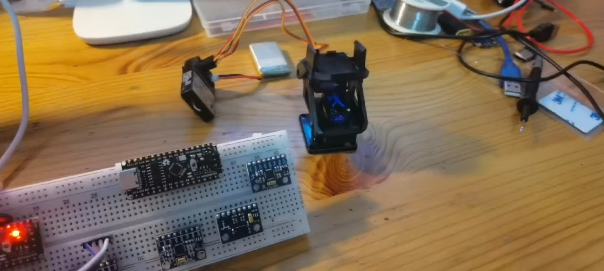
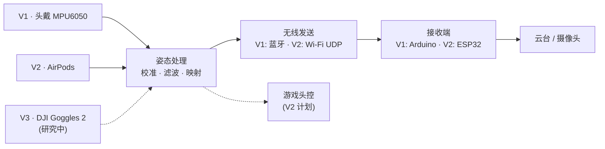

# 天眼头追系统 SkyEye Head Tracking

**用头部动作控制无人机云台**：转动头部，远端摄像头跟着转动，一个人就能同时操控飞行器和任务载荷。

<p align="center">
  
  <br><sub>V1 第一代数据采集模块开发板测试</sub>
</p>

## 版本

| 版本 | 状态 | 方案 | 文档 |
|---|---|---|---|
| **V1** | ✅ 已完成（历史版本） | 自制头戴模块：Arduino + MPU6050 + HC-05 蓝牙 → PPM → 云台 | [v1/](v1/README.md) |
| **V2** | 🚧 开发中（设计阶段） | Apple AirPods 头部追踪 → MacBook / iPhone → Wi-Fi UDP → ESP32 → 云台；另有 FPS 游戏头控模式 | [v2/](v2/README.md) |
| **V3** | 🔬 研究中（可行性研究） | 直接读取 DJI Goggles 2 内置的头部姿态数据（能否读到尚不确定） | [v3/](v3/README.md) |

- **V1** 的源代码、3D 外壳、支撑材料和测试视频都在 `v1/`。另有一份[优化版代码](v1/firmware/optimized/README.md)（⚠️ 未经验证：没有编译过，也没有在硬件上运行过）。
- **V2** 目前只在 MacBook 上初步确认了 AirTracker 能实时追踪头部，其余功能**都还没有实现**。
- **V3** 目前只完成了资料调研，**没有做过任何硬件验证**。

## 系统架构

三个版本的区别在于头部姿态从哪里来；后面「姿态处理 → 发送 → 云台」这条链路是一样的思路。V2 起会把这部分做成共用模块。



## 仓库目录

```
SKY-EYES/
├── README.md          # 项目首页（本页）
├── assets/            # 首页和文档用的图片
├── v1/                # V1：已完成的历史版本
│   ├── README.md      #   V1 完整介绍（中英文）
│   ├── firmware/      #   Arduino 源代码（原版 + 未经验证的优化版）
│   ├── hardware/      #   3D 打印外壳（STL）
│   ├── docs/          #   支撑材料
│   └── media/         #   测试视频
├── v2/                # V2：AirPods 头部追踪（设计文档）
└── v3/                # V3：DJI Goggles 2 头部追踪（研究文档）
```

## English

SkyEye lets an operator steer a drone camera gimbal by moving their head.

- **V1** (completed, legacy): a custom head unit (Arduino + MPU6050 + HC-05 Bluetooth) whose receiver outputs PPM to the gimbal. Full description: [v1/README.md](v1/README.md).
- **V2** (in development, design stage): head orientation from Apple AirPods via AirTracker on macOS, processed in Python and sent over Wi-Fi UDP to an ESP32. Also plans an FPS gaming lean mode. See [v2/README.md](v2/README.md).
- **V3** (research / feasibility study): investigating whether head-tracking data can be read from DJI Goggles 2. This is not yet known. See [v3/README.md](v3/README.md).

## License

待定（To be decided）。在添加许可证之前，仓库内容默认保留所有权利。
