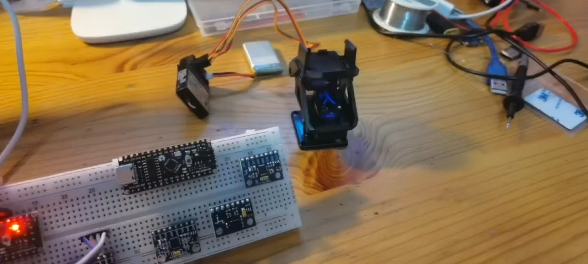
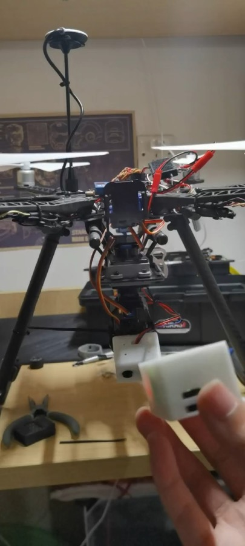

# 天眼头追系统 V1

> **状态：已完成（历史版本）**。本目录保存 V1 的全部源代码、3D 模型、支撑材料和测试视频。文件内容与最初上传时一致，只是整理了位置并改了更容易看懂的文件名（见第 3 节）。

[← 返回项目首页](../README.md) · [V2 文档](../v2/README.md) · [V3 文档](../v3/README.md)

<p align="center">
  
  <br><sub>第一代数据采集模块开发板测试（截自 <a href="media/第一代数据采集模块开发板测试视频.mp4">测试视频</a>）</sub>
</p>

## 1. 作品简介

本项目旨在开发一款创新性的无人机天眼头追系统，将人的头部与无人机云台摄像头及相关任务模块融为一体，极大地提高了操作效率。本项目的创新点在于使用移动头部来操控无人机云台和相关任务模块进行移动，区别于传统使用电位器滑轮进行操作，将人的眼睛与无人机云台摄像头及相关任务模块融为一体，实现了单人操作无人机及任务模块的功能。该系统由无人机平台、数据采集模块、图像发射模块和无人机操作装置四部分组成。数据采集模块采用Arduino nano 开发板搭配mpu6050电子陀螺仪模块、HC05蓝牙传感器模块等配件，实现数据采集与传输。无人机平台采用f550六旋翼无人机和DJI NAZA飞行器控制模块等设备。无人机操作装置和图像发射模块则分别使用opentx操作系统和能接收5.8Ghz图像传输信号的设备。

## 2. 各系统组成部分

- 第一代数据采集模块（采用外置供电与有线连接）
- 第二代数据采集模块（采用内置供电与无线连接，包括数据采集模块主模块与数据采集模块从模块）
- F550六旋翼无人机（具备救援物质投放能力）
- 目标指示模块（包括激光指示与LED亮白光指示）
- 数据采集模块开发板

<p align="center">
  
  <br><sub>第二代数据采集模块与 F550 六旋翼无人机（截自 <a href="media/第二代数据采集模块与六旋翼无人机测试视频.mp4">测试视频</a>）</sub>
</p>

## 3. 目录与文件

```
v1/
├── firmware/
│   ├── head_unit/head_unit.ino      # 头戴端（主模块）：MPU6050 → HC-05
│   ├── receiver/receiver.ino        # 接收端（从模块）：HC-05 → D2 引脚 PPM 输出
│   └── optimized/                   # 优化版代码（⚠️ 未经验证）
├── hardware/
│   ├── head_unit_case.stl           # 主模块外壳
│   ├── receiver_case.stl            # 从模块外壳
│   └── 无.stl
├── docs/
│   └── 天眼头追系统支撑材料1.docx
└── media/
    ├── 第一代数据采集模块开发板测试视频.mp4
    └── 第二代数据采集模块与六旋翼无人机测试视频.mp4
```

| 现在的位置 | 原文件名 |
|---|---|
| `firmware/head_unit/head_unit.ino` | `sketch_jan09a.ino` |
| `firmware/receiver/receiver.ino` | `sky_eyes_slave.ino` |
| `firmware/optimized/` | `v1-optimized/`（里面的两个程序同样改名为 `head_unit_optimized`、`receiver_optimized`） |
| `hardware/head_unit_case.stl` | `master.stl` |
| `hardware/receiver_case.stl` | `slave.stl` |
| `hardware/无.stl` | `无.stl`（用途待补充，暂时保留原名） |

Arduino IDE 要求 `.ino` 文件放在同名文件夹里，所以每个程序单独一个文件夹。3D 模型是用 Shapr3D 导出的（见 STL 文件头）。

## 4. 安装与使用

- **飞行器端**：飞行器端使用 PWM 信号控制的两轴或者三轴云台，系统默认输出 PWM 信号或 PPM 信号。
- **地面端**：地面端分为两部分，遥控器模块和头戴模块。
  - 头戴模块：Arduino nano 33 BLE、mpu 6050、HC-05 蓝牙模块
  - 遥控模块：Arduino nano 33 BLE、HC-05 蓝牙模块
- 当硬件连接完成时，将连接好的开发板放入已经打印好的 3D 模型中。

> 注：原始文档写的是 Arduino Nano 33 BLE，但代码直接用 `Serial` 连接 HC-05，更像经典 Arduino Nano 的接法。实际使用的板子型号待作者确认。

## 5. 代码说明

| 程序 | 作用 |
|---|---|
| [head_unit.ino](firmware/head_unit/head_unit.ino) | 用 `MPU6050_light` 读取俯仰（Y 轴）和偏航（Z 轴）角，加 90° 后取整。俯仰发偶数、偏航发奇数，每个轴 1 字节，通过 9600 波特率串口经 HC-05 发出 |
| [receiver.ino](firmware/receiver/receiver.ino) | 按奇偶性把字节分回两个轴，映射成脉宽，在 D2 引脚输出 8 通道 PPM（20 ms 一帧）。第 1–6 通道固定为 1500 µs，第 7、8 通道是头部的两个轴 |

**优化版**：[firmware/optimized/](firmware/optimized/README.md) 在不改硬件、不改接口的前提下修复了数组越界、调试打印拖慢 PPM 等问题。⚠️ **这份代码未经验证**：没有编译过，也没有在硬件上运行过。

---

## English

### Introduction

This project aims to develop an innovative UAV sky eye head tracking system, which integrates the human head with the UAV gimbal camera and related task modules, greatly improving the operation efficiency. The innovation of this project lies in using the movement of the head to control the movement of the UAV gimbal and related task modules. Different from the traditional operation using potentiometer pulleys, it integrates human eyes with the UAV gimbal camera and related task modules, realizing the function of single-person operation of the UAV and task modules. The system consists of four parts: UAV platform, data acquisition module, image transmission module and UAV operation device. The data acquisition module adopts Arduino nano development board with mpu6050 electronic gyroscope module, HC05 Bluetooth sensor module and other accessories to realize data acquisition and transmission. The UAV platform uses f550 hexacopter UAV and DJI NAZA flight control module and other equipment. The UAV operation device and image transmission module use opentx operating system and devices capable of receiving 5.8Ghz image transmission signals respectively.

### Components of Each System

- The first-generation data acquisition module (with external power supply and wired connection)
- The second-generation data acquisition module (with built-in power supply and wireless connection, including the main module of the data acquisition module and the slave module of the data acquisition module)
- F550 hexacopter UAV (with the ability to drop rescue materials)
- Target indication module (including laser indication and LED white light indication)
- Data acquisition module development board

### Installation and Use

- **Aircraft end**: The aircraft end uses a two-axis or three-axis gimbal controlled by PWM signal, and the system outputs PWM signal or PPM signal by default.
- **Ground end**: The ground end is divided into two parts: remote control module and head-wearing module.
  - Head-wearing module: Arduino nano 33 BLE, mpu 6050, HC-05 Bluetooth module
  - Remote control module: Arduino nano 33 BLE, HC-05 Bluetooth module
- When the hardware connection is completed, put the connected development board into the printed 3D model.
