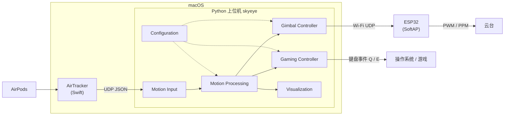

# 天眼头追系统 V2 · SkyEye Head Tracking System V2

> **文档状态：设计草稿（Draft）**
> 本文档描述 V2 的设计目标与架构。除「项目状态」一节中明确标注为已完成的内容外，其余均为**设计或计划**，尚未实现或验证。

---

## 1. 项目简介

天眼头追系统让操作者通过转动头部直接控制无人机云台，把操作者的视线和云台摄像头联动起来，从而实现单人同时操控飞行器和任务载荷。

**V1（2022–2023）** 使用自制头戴模块（Arduino Nano + MPU6050 + HC-05 蓝牙）采集头部姿态，通过蓝牙传给接收端，再转换成 PPM 信号控制云台。

**V2** 重新设计了姿态采集、数据处理和通信链路：

- **不再需要专用头戴硬件**：头部姿态改用 Apple AirPods 内置的头部追踪传感器获取。
- **以软件为核心**：姿态解析、校准、滤波、映射全部放在上位机 Python 程序中完成，便于测试和替换。
- **Wi-Fi 直连**：ESP32 自建热点（SoftAP），MacBook 直接连接，通过 UDP 通信，不需要路由器或互联网。
- **新增游戏模式（Gaming Mode）**：复用同一套姿态处理模块，用头部侧倾（Roll）触发 Q/E 键，实现 FPS 游戏中的左右侧身。

```
AirPods ──(Apple 私有)──▶ macOS · AirTracker ──UDP JSON──▶ Python 上位机 ──Wi-Fi UDP──▶ ESP32 ──PWM/PPM──▶ 云台
                                                              │
                                                              └──▶ Gaming Controller ──键盘事件──▶ 游戏
```

### English Summary

SkyEye lets an operator steer a drone camera gimbal by moving their head. V1 (2022–2023) used a custom head-mounted unit (Arduino Nano + MPU6050 + HC-05 Bluetooth) that output PPM. V2 is a redesign that drops the custom headset. It reads head orientation from Apple AirPods through the open-source macOS app [AirTracker](https://github.com/crippler95/airtracker), and processes it in a modular Python 3 host: calibration, filtering, dead zone and mapping. The host sends commands over a direct Wi-Fi UDP link to an ESP32 in SoftAP mode, which will drive the gimbal. V2 also plans a separate Gaming Mode that maps head roll to the Q/E lean keys in FPS games. **V2 is in the design stage.** Apart from a first check that AirTracker tracks the head in real time on a MacBook, none of the V2 features below are implemented yet.

---

## 2. 项目状态

| 类别 | 内容 | 状态 |
|---|---|---|
| **V1 已有** | 头戴采集模块程序 `sketch_jan09a.ino`、接收端 PPM 输出程序 `sky_eyes_slave.ino` | ✅ 已有（历史版本，保留不改） |
| **V1 已有** | 3D 外壳模型（`master.stl`、`slave.stl`、`无.stl`）、支撑材料文档、测试视频 | ✅ 已有 |
| **V2 已验证** | 在 MacBook 上运行 AirTracker，初步确认能实时追踪头部 | ✅ 初步确认（未做定量测试） |
| **V2 开发中** | V2 架构设计与文档（本文档） | 🚧 进行中 |
| **V2 未开始** | Python 接收并解析 AirTracker 的 UDP 数据 | ⏳ 未开始 |
| **V2 未开始** | 姿态处理：校准、滤波、死区、映射 | ⏳ 未开始 |
| **V2 未开始** | ESP32 SoftAP 热点与 UDP 接收 | ⏳ 未开始 |
| **V2 未开始** | 姿态控制指令传输协议 | ⏳ 未开始（下文为草案） |
| **V2 未开始** | 实际云台驱动（PWM / PPM） | ⏳ 未开始 |
| **V2 未开始** | 游戏按键映射（Gaming Mode） | ⏳ 未开始 |
| **V2 未开始** | 端到端延迟测试 | ⏳ 未开始，暂无数据 |
| **未来计划** | iPhone 采集端、Windows 采集端、Windows 原生 AirPods 头部追踪研究、独立 Web UI | 📋 计划中 |

---

## 3. V1 技术背景

### 3.1 系统组成

V1 由四部分组成：无人机平台（F550 六旋翼 + DJI NAZA 飞控）、数据采集模块（头戴端 + 接收端）、5.8 GHz 图传，以及基于 OpenTX 的操作装置。数据采集模块先后做了两代：第一代外置供电、有线连接；第二代内置供电、无线连接。

### 3.2 V1 数据链路（根据源代码整理）

```
MPU6050 ──I²C──▶ Arduino（头戴端）──UART 9600──▶ HC-05 ~~蓝牙~~ HC-05 ──UART──▶ Arduino（接收端）──PPM（D2）──▶ 云台 / 遥控链路
```

| 文件 | 作用 |
|---|---|
| `sketch_jan09a.ino` | 头戴端：用 `MPU6050_light` 读取 Y 轴（俯仰）和 Z 轴（偏航）角度，加 90° 后取整；用奇偶性区分两个轴（俯仰发偶数、偏航发奇数），每个轴占 1 字节，经串口发给 HC-05 |
| `sky_eyes_slave.ino` | 接收端：按奇偶性把收到的字节分回两个轴，映射成脉宽，在 D2 输出 8 通道 PPM。第 1–6 通道固定为 1500 µs（占位），第 7、8 通道是头部的两个轴 |
| `*.stl` | 头戴端 / 接收端的 3D 打印外壳 |

### 3.3 V1 的局限（来自代码阅读，未经实测）

以下几点是阅读源代码得出的分析，没有经过实验测量，也不代表 V1 实际飞行中出现过问题：

1. **编码方式**：靠奇偶性区分轴，角度分辨率实际只有 2°。好处是每个字节都能自己表明属于哪个轴，丢一个字节只是少更新一次，不会把两个轴弄混。但没有校验，如果传输中最低位出错，这个字节会被当成另一个轴的数据。
2. **偏航漂移风险**：MPU6050 没有磁力计，偏航角只能靠陀螺仪积分得到，理论上会随时间漂移。
3. **通道只有两轴**：只传了俯仰和偏航，没有横滚。
4. **代码细节**：`chnum[8]` 的数组大小为 8，但程序访问了下标 8，属于越界访问。头戴端的 `ppmsig_post()` 调用被注释掉了。头戴端按 0–180 映射，接收端按 0–140 映射，两者不一致。脉宽映射到 0–1500 µs，而常见的舵机范围是 1000–2000 µs。
5. **硬件依赖**：需要专门制作、单独供电的头戴设备。
6. **待确认**：README 写的是 Arduino Nano 33 BLE，但代码直接用 `Serial` 连接 HC-05，这更符合经典 Arduino Nano 的接法（Nano 33 BLE 的 `Serial` 是 USB 口）。实际用的是哪块板，需要作者确认。

> V1 的所有文件都原样保留在仓库根目录，V2 不修改也不重构 V1 的程序。

---

## 4. V2 主要升级方向

| 方面 | V1 | V2 |
|---|---|---|
| 姿态来源 | 自制头戴 MPU6050 | AirPods 内置头部追踪（经 AirTracker） |
| 姿态轴 | 俯仰、偏航（2 轴） | 偏航、俯仰、横滚（3 轴） |
| 数据处理 | 在 Arduino 上做整数映射 | 在 Python 上位机里做校准、滤波、死区、映射 |
| 无线链路 | HC-05 蓝牙串口，9600 baud | ESP32 SoftAP + UDP，不需要路由器 |
| 数据格式 | 单字节，靠奇偶区分轴 | 带版本号、序号和时间戳的二进制帧（草案） |
| 失控保护 | 无 | ESP32 超时后保持当前位置或回中（计划） |
| 应用场景 | 无人机云台 | 无人机云台 + 游戏头部控制 |
| 可测试性 | 依赖硬件 | 各模块可单独测试，支持录制和回放（计划） |

---

## 5. V2 系统架构



设计原则：

- **单向数据流**：采集 → 处理 → 输出。各模块之间只通过统一的姿态数据结构 `Pose` 传递数据。
- **输入可替换**：AirTracker、iPhone、Windows、录制文件回放都实现同一个 `MotionSource` 接口。
- **输出相互独立**：云台控制和游戏控制共用处理结果，但各自启停，一个出错不影响另一个。
- **优先低延迟**：处理链路尽量简单，每次收到新数据立即处理，不额外缓冲。

---

## 6. 模块设计

### 6.1 Motion Input：头部追踪数据采集

- 统一接口 `MotionSource`，输出 `Pose(timestamp, yaw, pitch, roll, source)`，角度单位为度。
- **首个实现：`AirTrackerUdpSource`**。根据 AirTracker 项目文档（[PROTOCOL.md](https://github.com/crippler95/airtracker/blob/main/docs/PROTOCOL.md)），它会输出两种 UDP 数据：
  - JSON 流，端口 4243：每个采样一个 JSON 对象，`yprDegrees` 字段是 `[yaw, pitch, roll]`（单位：度），另有 `quaternion`、`resetCounter`、`packetsPerSecond` 等字段。
  - OpenTrack 流，端口 4242（可配置）：48 字节，6 个小端 float64，依次是 x、y、z、yaw、pitch、roll。
  - AirTracker 文档写的采样率约为 25 Hz。**这是该项目文档中的说法，本项目还没有实测。**
- 计划另做一个 `ReplaySource`，回放录制好的姿态数据，用于不接 AirPods 的单元测试和调试。
- 后续：`IPhoneSource`、`WindowsSource`。

### 6.2 Motion Processing：姿态处理

按以下顺序处理，每一步都可以单独开关和配置：

1. **归零（Recenter）**：以当前姿态作为零点，可以用快捷键或命令触发。
2. **坐标转换**：轴重新映射、方向取反，把 AirPods 坐标系对应到云台坐标系或游戏坐标系。
3. **滤波**：先用指数平滑（EMA），后续评估 One Euro Filter，在抖动和延迟之间做权衡。
4. **死区**：零点附近的小幅动作直接忽略。
5. **限幅与映射**：把角度限制在可用范围内，再按灵敏度曲线映射成输出量。

### 6.3 Gimbal Controller：云台控制

- 把处理后的姿态编码成控制帧（见第 7 节），通过 UDP 发到 ESP32。
- ESP32 以 SoftAP 模式运行，MacBook 连接它的热点。ESP32 在 SoftAP 模式下的默认 IP 一般是 `192.168.4.1`，以实际固件配置为准。
- 发送频率、超时时间等参数放在配置文件里，具体数值等实测后再确定。

### 6.4 ESP32 固件

- C/C++，计划用 Arduino 框架（PlatformIO 管理），以后视需要迁移到 ESP-IDF。
- 职责：建立 SoftAP 热点、接收 UDP、校验帧、输出 PWM（舵机或云台）或 PPM（兼容 V1 的接法）。
- **失控保护**：超过设定时间没收到有效帧时，按配置保持当前位置或回到中位。

### 6.5 Gaming Controller：游戏控制

用 Roll 角驱动一个带回滞的状态机，避免在临界角度附近反复触发：

```
            roll < -trigger                     roll > +trigger
  LEAN_LEFT ◀──────────────── CENTER ────────────────▶ LEAN_RIGHT

  LEAN_LEFT  → CENTER：roll > -(trigger - hysteresis)
  LEAN_RIGHT → CENTER：roll <  (trigger - hysteresis)
```

- Roll 的正负沿用 AirTracker 文档的约定（向右侧倾为正），可以在配置中取反。

- 可配置：触发角度、死区、回滞阈值、灵敏度、方向取反、按键映射（默认 Q / E）、按住模式或切换模式。
- 支持姿态归零，以及一键启用 / 暂停。
- macOS 上发送键盘事件需要用户在「系统设置 → 隐私与安全性 → 辅助功能」中授权。
- **反作弊声明**：本功能只通过操作系统的公开接口发送普通键盘事件，**不会**注入游戏进程，不使用内核驱动，也不尝试绕过或隐藏自身以躲避反作弊检测。部分在线游戏的反作弊系统可能拦截或限制模拟输入，用户应遵守所玩游戏的服务条款，优先在单机或明确允许外部输入设备的游戏中使用。

### 6.6 Visualization：可视化

- 初期：沿用 AirTracker 自带的网页查看器（据其文档，地址为 `http://localhost:4244`），再加上 Python 端的命令行状态输出，显示三轴角度、连接状态、丢包和帧率。
- 后期：做一个独立的 Web UI，同时显示原始姿态和处理后的姿态、云台指令、游戏按键状态和调试信息。

### 6.7 Configuration：配置

- 使用 JSON 配置文件（标准库即可读写，不需要额外依赖）。内置一份默认配置，用户配置单独存放，只覆盖需要修改的项。
- 包含：输入源、各处理步骤的参数、ESP32 地址和端口、游戏模式参数、轴映射。

---

## 7. 通信协议草案（上位机 → ESP32）

> **草案，尚未实现，字段可能调整。**

UDP 负载，小端序，共 18 字节：

| 偏移 | 字段 | 类型 | 说明 |
|---|---|---|---|
| 0 | `magic` | uint16 | 固定为 `0x5345`（"SE"） |
| 2 | `version` | uint8 | 协议版本，目前为 1 |
| 3 | `flags` | uint8 | bit0：输出使能（armed）；bit1：请求回中；其余保留 |
| 4 | `seq` | uint32 | 递增序号，用于发现丢包和乱序 |
| 8 | `t_ms` | uint32 | 上位机发送时的单调时钟（毫秒），用于延迟测量 |
| 12 | `yaw` | int16 | 单位 0.01° |
| 14 | `pitch` | int16 | 单位 0.01° |
| 16 | `roll` | int16 | 单位 0.01° |

ESP32 规则（计划）：

- `magic` 或 `version` 不对的帧直接丢弃。
- `seq` 比上一帧旧的帧丢弃。
- `armed` 位为 0 时不驱动云台。
- 超时后执行失控保护。

---

## 8. 目录结构

V1 的文件**全部留在原位置不动**，V2 的内容集中放在 `v2/` 目录下：

```
SKY-EYES/
├── README.md                     # V1 README（审核通过后再决定是否更新、怎么更新）
├── sketch_jan09a.ino             # V1 头戴端程序（保留，不修改）
├── sky_eyes_slave.ino            # V1 接收端程序（保留，不修改）
├── master.stl / slave.stl / 无.stl  # V1 3D 外壳模型
├── 天眼头追系统支撑材料1.docx       # V1 支撑材料
├── 第一代数据采集模块开发板测试视频.mp4
├── 第二代数据采集模块与六旋翼无人机测试视频.mp4
│
└── v2/
    ├── README.md                 # 本文档
    ├── docs/
    │   ├── architecture.md       # 架构与模块接口说明
    │   ├── protocol.md           # 上位机 ↔ ESP32 通信协议
    │   ├── gaming-mode.md        # 游戏模式设计、权限与反作弊说明
    │   └── test-plan.md          # 测试与延迟测量方法
    │
    ├── host/                     # Python 3.11+ 上位机
    │   ├── pyproject.toml
    │   ├── skyeye/
    │   │   ├── __main__.py       # 命令行入口
    │   │   ├── pose.py           # Pose 数据结构（dataclass）
    │   │   ├── input/            # Motion Input
    │   │   │   ├── base.py       #   MotionSource 接口
    │   │   │   ├── airtracker.py #   AirTracker UDP 接收与解析
    │   │   │   └── replay.py     #   录制数据回放
    │   │   ├── processing/       # Motion Processing
    │   │   │   ├── calibration.py#   归零、坐标转换
    │   │   │   ├── filters.py    #   EMA / One Euro
    │   │   │   └── mapping.py    #   死区、限幅、曲线映射
    │   │   ├── gimbal/           # Gimbal Controller
    │   │   │   ├── protocol.py   #   控制帧编解码
    │   │   │   └── udp_sender.py
    │   │   ├── gaming/           # Gaming Controller
    │   │   │   ├── lean.py       #   Roll 回滞状态机
    │   │   │   └── keyboard.py   #   键盘事件输出（按平台实现）
    │   │   ├── visualization/    # 命令行状态显示，后期接 Web UI
    │   │   └── config/           # 配置加载、默认值、校验
    │   ├── configs/
    │   │   └── default.json
    │   └── tests/                # 单元测试（基于回放数据，不需要硬件）
    │
    ├── firmware/
    │   └── esp32_gimbal/         # ESP32 固件（PlatformIO + Arduino 框架）
    │       ├── platformio.ini
    │       ├── include/protocol.h
    │       └── src/main.cpp
    │
    ├── tools/                    # 数据录制、协议调试、延迟测量脚本
    └── hardware/                 # V2 接线图、物料清单（BOM）
```

`host/`、`firmware/` 等目录会随开发逐步创建，**目前只有本文档**。

---

## 9. 测试与验证计划

> 以下全部是**计划**，目前没有任何测试结果。

| 测试项 | 方法 |
|---|---|
| 解析正确性 | 用录制的 AirTracker 数据跑单元测试 |
| 处理算法 | 用人工构造的姿态序列验证归零、死区、回滞、限幅 |
| 协议 | 编码和解码结果一致；对错误帧、旧帧、超时进行测试 |
| 链路延迟 | ESP32 把 `seq` 和 `t_ms` 原样回传，上位机计算往返时间（RTT） |
| 端到端延迟 | 用高速摄像同时拍摄头部动作和云台动作，逐帧对比 |
| 采样率与丢包 | 统计实际收到的帧率和 `seq` 的缺口 |
| 失控保护 | 断开 Wi-Fi 或关闭上位机，观察 ESP32 的行为 |

测试结果会附上测试条件（设备型号、系统版本、距离、环境），整理在 `docs/test-plan.md` 中。

---

## 10. 路线图

| 阶段 | 内容 |
|---|---|
| M0 | V2 架构与文档（当前阶段） |
| M1 | Python 接收并解析 AirTracker 数据，命令行实时显示三轴角度 |
| M2 | 姿态处理模块 + 录制回放 + 单元测试 |
| M3 | ESP32 SoftAP + UDP 接收 + 舵机测试台验证 |
| M4 | 驱动实际云台，加入失控保护，测量延迟 |
| M5 | Gaming Mode（macOS） |
| 之后 | iPhone 采集端、Windows 采集端、Windows 原生 AirPods 头部追踪研究、独立 Web UI |

---

## 11. 安全说明

- 调试云台时建议**拆下螺旋桨**，或者只在舵机测试台上进行。
- 第一次联调时先关闭输出使能（armed），确认角度方向和范围都正确后再开启。
- 本项目只用于学习和研究。实际飞行请遵守当地无人机法规。

---

## 12. 相关项目

| 项目 | 用途 |
|---|---|
| [AirTracker](https://github.com/crippler95/airtracker) | macOS 上读取 AirPods 头部姿态并通过 UDP 输出（V2 原型的数据来源，MIT 许可） |
| [Headitude](https://github.com/DanielRudrich/Headitude) | AirPods 头部追踪的另一种实现，供参考 |
| [OpenTrack](https://github.com/opentrack/opentrack) | 通用头部追踪软件，可作为游戏控制的参考或替代方案 |

---

## 13. 许可证

待定。仓库目前没有 LICENSE 文件。
