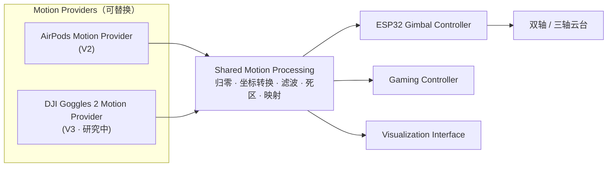

# 天眼头追系统 V3：DJI Goggles 2 原生头部追踪集成研究

> **V3 Status: Research / Feasibility Study**
>
> 本文档是 V3 的**可行性研究与开发规划**，不是功能说明。本项目目前**没有**用任何方式从 DJI Goggles 2 读到过头部追踪数据，也没有做过任何硬件实验。文中所有技术判断都尽量标明了出处；没有出处的内容都标注为「推测」或「待验证」。
>
> 资料调研日期：2026-11-09。所引用的第三方项目可能会随时更新。

---

## 1. 项目简介与 V3 愿景

天眼头追系统让操作者转动头部来控制无人机云台，把操作者的视线和远端摄像头的朝向联动起来。

V1 用自制的头戴 IMU，V2 改用 AirPods 内置的头部追踪传感器。V3 想再进一步：**直接使用 FPV 飞行时本来就戴着的 DJI Goggles 2 里的姿态传感器**，不再需要 AirPods 或额外的头戴 IMU 模块。

目标链路：

```
DJI Goggles 2 ──(获取方式待研究)──▶ Head Tracking Data ──▶ 主机 / ESP32 ──▶ 云台
```

V3 的长期愿景是一套一体化的 FPV 头追系统：

- 戴上 Goggles 2 后，在正常看图传画面的同时，用头部动作控制第三方云台或摄像头。
- **尽量不影响 Goggles 2 原有的 FPV 图传功能。**
- 复用 V2 的姿态处理、通信、可视化和云台控制模块（见第 9 节）。

### English Summary

V3 is a **research / feasibility study**. It asks whether a third-party program can read head-orientation data (Yaw / Pitch / Roll, or raw IMU data) from **DJI Goggles 2**, without modifying firmware, and use it to drive an external gimbal. DJI Goggles 2 has an official Head Tracking feature, but none of the open-source projects reviewed here document a way to read head-tracking or IMU data. As of this writing, it is **not known** whether such data is reachable over USB-C, over the O3 wireless link, or at all without firmware changes. If it turns out to be possible, a DJI Goggles 2 Motion Provider would plug into the same motion-processing and gimbal pipeline as V2's AirPods provider.

---

## 2. V1 / V2 / V3 技术演进

| | V1 | V2 | V3 |
|---|---|---|---|
| 状态 | 历史版本（已有代码与硬件资料） | 开发中（设计文档阶段） | **Research / Feasibility Study** |
| 姿态来源 | 自制头戴 MPU6050 | Apple AirPods 头部追踪 | DJI Goggles 2 内置传感器（待研究） |
| 采集端 | Arduino Nano | MacBook / iPhone（AirTracker） | 获取方式待定（USB-C / 无线 / 其他） |
| 传输 | HC-05 蓝牙串口 | Wi-Fi UDP → ESP32 | 计划复用 V2 的 UDP → ESP32 |
| 输出 | PPM | ESP32 → 云台；Gaming Mode | 复用 V2 的输出模块 |
| 额外头戴硬件 | 需要 | 需要 AirPods | 目标是不再需要 |

相关文档：

- V1：[v1/README.md](../v1/README.md)（源代码、3D 模型和测试视频都在 `v1/` 中）
- V2：[v2/README.md](../v2/README.md)

---

## 3. DJI Goggles 2 设备与头追功能概述

### 3.1 型号区分（重要）

DJI 有多款名字相近的 FPV 眼镜。它们的系统和协议并不相同，**一个型号上的研究成果不能直接当作 Goggles 2 上已经验证的结果**。

| 型号 | 本文中的处理方式 | 依据 |
|---|---|---|
| **DJI Goggles 2** | **V3 的研究对象**。和 DJI Avata、DJI O3 Air Unit 一起使用（O3 / O3+ 图传） | DJI 官方商城页面 [S1]；o3-usb-decoder 列为已在实机验证的设备 [S5] |
| DJI Goggles Integra | 与 Goggles 2 同代，但是不同型号。G2 Bridge 记录的设备标识是 `E3T ZV901`，Goggles 2 是 `E3T ZV900` | G2 Bridge PROTOCOL.md [S7] |
| DJI FPV Goggles V2 | 上一代 DJI FPV 系统的眼镜，**不是 Goggles 2**。o3-usb-decoder 说明 FPV Goggles V1/V2 使用另一种 bulk 协议（`0x524d5654`），不在它的支持范围内 | o3-usb-decoder README [S5] |
| DJI Goggles 3 | 新一代眼镜，**不是 Goggles 2**。o3-usb-decoder 明确写了不支持 Goggles 3，并列为「Untested」 | o3-usb-decoder README、SUPPORTED_HARDWARE.md [S5] |
| DJI Goggles N3 | dji_protocol 中做过验证的眼镜型号，**不是 Goggles 2** | dji_protocol usb_mobile_protocol.md [S6] |

### 3.2 官方头部追踪功能（已确认）

- DJI 官方商城页面介绍，Goggles 2 的头部追踪功能可以「用头部动作控制无人机相机」[S1]。
- 《DJI Goggles 2 用户手册》v1.0（2022.11）的目录中有「Using the Head Tracking Function」一节 [S2]。
- DJI Avata 的固件更新说明中有一条：「Added orientation indicator when using the Head Tracking function with DJI Goggles 2」[S3]。

可以确认的事实只有：**Goggles 2 有官方头追功能，在 DJI 自家的系统里头部动作能控制相机或飞行器。**

以下内容**尚未确认**：

- 手册中头追功能支持哪些飞行器，用 O3 Air Unit 时能不能用，以及具体能控制哪些轴、角度范围多大。
  - 原因：手册 PDF 超过了在线读取工具的大小限制，本次没有读到正文。需要人工查阅手册第 36 页附近的内容来补充。
- 头追数据在 DJI 系统内部是怎么传递的。
  - **推测**：既然 Avata 的相机能跟随头部动作，头追信息很可能通过 O3 无线链路从眼镜传到了飞行器。但这只是根据功能表现做的推断，没有找到任何协议层面的资料证实。

### 3.3 已公开的 Goggles 2 USB 信息（来自第三方逆向研究）

下面的内容来自第三方项目文档，**本项目没有在自己的设备上复现过**：

| 项目 | 内容 | 来源 |
|---|---|---|
| USB 标识 | `2ca3:0020`（DJI Technology Co., Ltd. `e3t`） | [S5]、[S7] |
| 默认 USB 组成 | 复合设备，有 8 个接口：RNDIS、Mass Storage、ACM，以及 5 个厂商自定义 bulk 接口（接口 3–7，最大包长 512 B） | [S5] |
| DUML 心跳 | 接口 4 上能看到 DUML 心跳；接口 3、5、6、7 在主机不发数据时没有任何流量 | [S5] |
| 视频接口 | G2 Bridge 使用 MI04（class/subclass/protocol `ff/43/01`），bulk OUT `0x04` / IN `0x85`，DUML V1 封装，视频命令 `0b/53` | [S7] |
| RNDIS 网络 | 网段 `192.168.60.0/24`（眼镜是 `.2`）；21 端口有 FTP 服务 | [S5] |
| AOA 模式 | 树莓派模拟 DJI Fly 手机，眼镜进入 Android Open Accessory 模式（`18d1:2d01`）后推送 H.264 视频（帧头 `55 CC 4A 57`） | [S5] |
| DUML 校验 | CRC8 种子 `0x77`、CRC16 种子 `0x3692` | [S5] |
| 遥测 | AOA 链路上除了视频还有遥测流量（约 11–18 kbit/s），但**字段内容没有公开** | [S5] |
| 已测固件 | G2 Bridge：Goggles 2 固件 01.11.00.00、01.14.00.00；有 issue 报告 01.12 固件下黑屏 | [S7] |

**结论：目前已公开的 Goggles 2 USB 研究都集中在视频（读取图传视频，或者把视频送进眼镜显示），没有任何一个项目提到头部追踪、IMU、陀螺仪或姿态数据。**

---

## 4. V3 目标架构

V3 不推翻 V2，而是给 V2 增加一个新的输入源：



DJI Goggles 2 Motion Provider 可能的部署方式（都**有待验证**）：

| 方式 | 说明 | 前提条件 |
|---|---|---|
| ① 主机中转 | Goggles 2 通过 USB-C 连接 Mac、PC 或 Linux 单板机（如树莓派）。主机解析数据后输出统一的 `Pose`，再沿用 V2 的 UDP → ESP32 链路 | USB 上能读到姿态数据 |
| ② ESP32 直连 | ESP32-S3 等支持 USB Host 的芯片直接和 Goggles 2 通信 | 方案 ① 已经跑通，而且协议足够简单，单片机能够实现 |
| ③ 经飞控 / 接收机 | 如果 DJI 系统本身会把头追信息以通道等形式输出给飞控，就从那里取数据 | 需要确认 DJI 是否提供这类输出；目前没有找到证据 |

---

## 5. 可行性分析

| 维度 | 现状 | 初步判断 |
|---|---|---|
| 设备有没有头追传感器 | 有官方头追功能 [S1][S2] | ✅ 硬件能力确定存在 |
| 有没有公开接口 | DJI 没有为 Goggles 2 提供公开的头追数据接口（本次调研没有找到） | ❌ 没有官方途径 |
| USB 协议基础 | Goggles 2 的 USB 枚举、DUML 封装、视频通道已有第三方记录 [S5][S7] | 🟡 有研究基础，但都和视频有关 |
| USB 上有没有姿态数据 | 没有任何资料提到 | ❓ 未知，是 V3 最关键的问题 |
| 无线链路 | INAV 社区有人提出过同样的问题，但无人回答 [S4] | ❓ 未知，难度高 |
| 不影响原有图传 | o3-usb-decoder、G2 Bridge 都需要眼镜进入特定的工作模式 [S5][S7] | ❓ 待验证，可能有冲突 |
| 固件更新的影响 | o3-usb-decoder 提醒：「A DJI firmware update can break it without warning」[S5] | ⚠️ 长期维护有风险 |

**总体判断**：V3 的硬件基础是有的，但「第三方能否读到头追数据」目前**完全没有证据**，既不能证明可行，也不能证明不可行。下一步应该先在自己的设备上做低风险、只读的验证（第 10 节的 R1–R3），再决定是否进入开发。

---

## 6. 研究方向

### 方案 A：USB-C 通信分析（优先）

**目标**：确认 Goggles 2 的 USB-C 接口上有没有能读取的头追或 IMU 数据。

研究内容：

1. **设备枚举**：在不同模式下（正常开机、连接飞行器、Virtual Flight 模式等）记录 USB 描述符、接口和端点，和 [S5][S7] 的记录对照，并记下固件版本。
2. **被动抓包**：在 Linux 上用 `usbmon` 加 Wireshark 抓取 USB 流量，只观察，不主动发送数据。
3. **对照实验**：在相同条件下，分别开启和关闭头追功能抓包，再做「静止 → 只转偏航 → 只转俯仰 → 只做侧倾」这样的标准动作序列，找出数值和头部动作相关的字段。
4. **DUML 解析**：利用已公开的 DUML 封装和校验信息 [S5][S6][S7] 解码流量，按发送方、接收方、命令集、命令号分类统计。
5. **RNDIS 网络流量**：观察 `192.168.60.0/24` 上已经存在的流量。不扫描，不尝试登录。
6. **数据质量**：如果找到了姿态字段，再测更新频率、延迟、坐标系和单位。

注意事项：

- **优先只读**。如果必须发送数据（比如进入某种模式需要握手），只使用开源项目已经公开、并且说明过影响的握手流程，同时评估对设备的风险。
- o3-usb-decoder 记录到 21 端口的 FTP 服务拒绝了默认密码，作者随后停止了尝试 [S5]。**本项目同样不做任何口令尝试或绕过认证的操作。**
- macOS 上抓 USB 包可能需要改动系统安全设置（待确认），因此**建议用一台 Linux 机器专门抓包**，不要为此修改 Mac 的安全设置。

### 方案 B：无线通信协议研究

**目标**：了解头追控制信息是否经过 O3 链路传输，以及有没有**合法、可靠**的方式拿到它。

- **不预设**无线数据流中一定有可以访问的姿态数据。
- 优先排查 DJI 系统本来就有的输出方式，例如 O3 Air Unit 和飞控之间的接口（INAV 讨论中提到的 RC 通道或 MSP 方式 [S4]），确认 DJI 是否会把头追信息输出给第三方飞控。
- **不做**无线信号的截获、解密或重放，也**不修改**发射设备。这类操作可能违反无线电管理规定，而且 O3 是私有协议，可靠性也无法保证。
- 本方向在没有找到公开资料之前只做文献调研。

### 方案 C：内部软件与 IMU 接口研究（仅做评估）

前提：方案 A、B 都不可行时才考虑。

- 只评估可行性和风险：比如固件中是否存在姿态融合或头追相关的模块，这些模块的输出会不会出现在外部接口上。
- **不进行**固件修改、破解、刷写、root、拆机改线等任何可能损坏设备、使保修失效或违反服务条款的操作。
- 如果结论是「只能改固件才能实现」，就把它记录为 V3 的研究结论，**不往下实施**。

---

## 7. 相关开源项目与参考资料

### 7.1 用户指定的四个项目（逐一核查）

| 项目 | 实际内容 | 适用设备 | 是否涉及头追 / IMU | 对 V3 的价值 |
|---|---|---|---|---|
| [dr00min/o3-usb-decoder](https://github.com/dr00min/o3-usb-decoder) [S5] | 树莓派 4 模拟 Android 配件（AOA），接收 Goggles 2 通过 USB 输出的 H.264 视频，再从 HDMI 输出。MIT 许可 | **DJI Goggles 2** + O3 Air Unit（实机验证）；明确不支持 FPV Goggles V1/V2、Integra、Goggles 3、N3 | **没有**提到。README 写明不做遥测叠加 | ⭐⭐⭐ 目前关于 Goggles 2 USB 协议最详细的资料（枚举信息、DUML、遥测流量） |
| [samuelsadok/dji_protocol](https://github.com/samuelsadok/dji_protocol) [S6] | DJI 私有协议的部分逆向文档：Mavic Pro 的 UDP / USB 协议、USB 手机协议（MFI）、DUML（作者自己标为 stub） | Mavic Pro、Goggles N3、O4 Air Unit。**没有提到 Goggles 2、FPV Goggles V2、Goggles 3、O3** | **没有**提到 | ⭐⭐ DUML 和 DJI 私有 UDP 协议的背景知识。**它和用户最初描述的「Goggles 2 协议研究」不一致**，不能当作 Goggles 2 的资料使用 |
| [iNavFlight/inav discussion #11018](https://github.com/iNavFlight/inav/discussions/11018) [S4] | 标题「head tracking DJI Goggles 2 and INAV」（2025-09-07）。提问者想知道 INAV 能否通过 Air Unit / O3 / O4 读取 Goggles 2 的陀螺仪数据，或者以 RC 通道或 MSP 的形式拿到 | DJI Goggles 2 | 只是**提问**，没有任何技术回答。目前显示「Unanswered」，唯一的回复是「good question」 | ⭐ 说明社区有同样的需求，也说明**目前没有公开的解决方案** |
| [Ammaar-Alam/g2-bridge](https://github.com/Ammaar-Alam/g2-bridge) [S7] | 在 Virtual Flight 模式下，通过 USB 把 Windows 或 Mac 的桌面画面推送到 Goggles 2 / Integra 显示（方向是电脑 → 眼镜）。GPL-3.0 许可 | **DJI Goggles 2**（`E3T ZV900`）、Goggles Integra（`E3T ZV901`） | **没有**提到 | ⭐⭐⭐ 提供了 Goggles 2 的 USB 接口和端点、DUML V1 帧格式、已测固件版本；Virtual Flight 模式也是一个值得观察的场景 |

### 7.2 资料来源

| 编号 | 资料 |
|---|---|
| [S1] | DJI 官方商城：DJI Goggles 2 产品页 — <https://store.dji.com/product/dji-goggles-2> |
| [S2] | DJI Goggles 2 User Manual v1.0（2022.11），lensrentals 镜像 — <https://www.lensrentals.com/product-assets/0504a4dc-0d37-4ec5-a656-cad0a123823d/DJI_Goggles_2_User_Manual_v1.0_en.pdf>（本次只确认了目录，正文待查） |
| [S3] | DJI Avata Release Notes（第三方转载）— <https://xcopter.com/download/DJ123I_Avata_Release_Notes_EN.pdf> |
| [S4] | iNavFlight/inav Discussion #11018 — <https://github.com/iNavFlight/inav/discussions/11018> |
| [S5] | dr00min/o3-usb-decoder：README、`docs/protocol_notes.md`、`docs/SUPPORTED_HARDWARE.md` — <https://github.com/dr00min/o3-usb-decoder> |
| [S6] | samuelsadok/dji_protocol：README、`udp_protocol.md`、`usb_protocol.md`、`usb_mobile_protocol.md`、`mb_protocol.md` — <https://github.com/samuelsadok/dji_protocol> |
| [S7] | Ammaar-Alam/g2-bridge：README、`docs/PROTOCOL.md`、Issues — <https://github.com/Ammaar-Alam/g2-bridge> |

---

## 8. 当前技术难点和风险

| 类别 | 难点 / 风险 | 应对 |
|---|---|---|
| 技术 | 头追数据可能根本不经过 USB，只在眼镜内部或无线链路中使用 | 用 R2 的对照实验尽早确认，设定明确的继续 / 放弃节点 |
| 技术 | DUML 中大部分命令的含义没有公开 | 先做统计分类和动作相关性分析，不需要完全理解协议 |
| 技术 | 读取数据需要眼镜处于特定模式，可能和正常图传冲突 | 每种模式都记录「图传是否正常」 |
| 技术 | 姿态数据的坐标系、单位、是否已经融合都不清楚 | 用标准动作序列标定；统一在 Shared Motion Processing 中转换 |
| 维护 | 固件更新可能让协议失效 [S5][S7] | 记录测试过的固件版本；解析代码设计成可以按固件版本适配 |
| 设备安全 | 往厂商自定义接口发送未知数据可能导致设备异常 | 只读优先；不写入未知命令；不刷机 |
| 飞行安全 | 头追控制云台时，延迟或数据错误会影响飞行操作 | 失控保护（沿用 V2 设计）；先在地面测试台上验证 |
| 法律 / 合规 | 逆向工程、无线电管理规定、DJI 服务条款 | 不截获或解密无线信号，不绕过认证，不分发 DJI 的固件或代码；各地法律不同，需要使用者自行确认 |
| 许可证 | o3-usb-decoder 是 MIT 许可，G2 Bridge 是 GPL-3.0 许可 | 参考它们的文档没有问题；如果复用 GPL 代码，需要注意许可证兼容性 |

---

## 9. 与 V2 软件平台的兼容方案

- **统一数据结构**：V3 的 Provider 输出和 V2 相同的 `Pose(timestamp, yaw, pitch, roll, source)`，角度单位为度，符号约定和 V2 一致。
- **统一接口**：实现 V2 定义的 `MotionSource` 接口（`read()` / `close()`）。上层模块不需要知道数据来自 AirPods 还是 Goggles 2。
- **共享处理**：归零、坐标转换、滤波、死区、映射都放在 Shared Motion Processing 中。Goggles 2 特有的坐标系差异只在它自己的 Provider 或配置的轴映射里处理。
- **共享输出**：ESP32 Gimbal Controller、Gaming Controller、Visualization 全部复用，不为 V3 单独开发。
- **录制回放**：如果 R3 找到了姿态字段，就把抓到的数据转成 V2 的回放格式，这样不接眼镜也能开发和测试。
- **配置切换**：在配置文件中选择 `source = "airpods"` 或 `source = "dji_goggles2"`。

---

## 10. 开发路线图与待验证问题

### 10.1 路线图

每个阶段结束时设一个**继续 / 放弃（Go / No-Go）**判断节点。

| 阶段 | 内容 | 产出 | 继续的条件 |
|---|---|---|---|
| **R0** | 文献与开源项目调研（**当前阶段**） | 本文档 | — |
| R1 | 被动 USB 枚举：在多种模式下记录描述符、接口和固件版本 | 枚举记录，并和 [S5][S7] 对比 | 能稳定复现已公开的枚举信息 |
| R2 | 被动抓包与头追开 / 关对照实验 | 抓包数据，以及数据和头部动作相关性的分析结果 | 找到和头部动作明显相关的流量 |
| R3 | 识别并标定姿态字段：坐标系、单位、更新频率、延迟 | 字段说明和实测数据（附测试条件） | 数据质量能满足云台控制 |
| R4 | 实现 DJI Goggles 2 Motion Provider 原型（主机中转） | 接入 V2 的处理链路 | 端到端可以用，且图传不受影响 |
| R5 | ESP32 集成和云台实测；评估 ESP32 直连的可能性 | 实测报告 | — |
| 备选 | 如果 R2 / R3 没有通过 | 写出「不可行」的研究结论，V3 回到 AirPods / 独立 IMU 方案 | — |

### 10.2 待验证的关键问题

1. 第三方程序能不能**直接读取** Goggles 2 的实时头追或 IMU 数据？
2. USB-C 接口上**会不会出现**姿态相关的数据？如果有，是在哪种模式下、哪个接口上？
3. 头追数据是只在眼镜内部和无线链路中使用，还是也会出现在外部接口上？
4. 能不能**在官方图传正常工作的同时**取到头追数据？
5. DJI 系统会不会把头追信息输出给第三方飞控（例如 RC 通道或 MSP）？
6. 如果能取到数据，实际的**更新频率、延迟、精度和坐标系**是多少？
7. 能不能**直接接 ESP32**（USB Host），还是必须经过主机中转？
8. 不同**固件版本**之间的差异有多大？固件更新后是否还能用？
9. Goggles 2 手册中头追功能支持哪些飞行器、能控制哪些轴、角度范围多大？（需要查阅手册正文）

---

## 免责声明

本项目与 DJI（大疆创新）没有任何关联。DJI、DJI Goggles 2、DJI Avata、O3 等是其各自所有者的商标。本文档只用于技术研究和规划，不提供也不鼓励任何破解、绕过安全保护或违反法律法规的操作。
